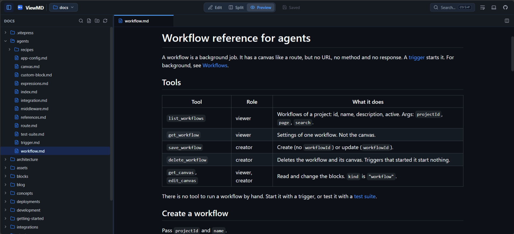

<p align="center">
  
</p>

<h1 align="center">ViewMD</h1>

<p align="center">
  <strong>Fast, bloat-free, 100% client-side Markdown viewer and editor running natively in your browser.</strong>
</p>

<p align="center">
  
  
  
  
  
  
  
</p>

<p align="center">
  
</p>

---

## 💡 Why ViewMD?

Most modern Markdown editors come with significant trade-offs:
- **Desktop Apps** (Obsidian, VS Code) consume 150MB–500MB of RAM through Electron runtimes.
- **Web-based Editors** often require cloud accounts, transmit your private notes to third-party servers, or lack direct local folder access.

**ViewMD** provides a zero-compromise alternative:
- **No Servers & No APIs**: Runs entirely client-side as a static web application.
- **Direct Disk Read & Write**: Opens local folders directly and saves changes straight back to disk using the modern **File System Access API**.
- **Blazing Fast**: Boots instantly with a tiny client bundle (< 1.5 MB uncompressed, ~480 kB gzipped).
- **GitHub Pages Ready**: Can be deployed to any static host with zero configuration.

---

## ✨ Features

### 📂 Native Local File System Access
- Open entire local project directories with full read/write capabilities (supported on Chromium browsers: Chrome, Edge, Brave, Opera).
- Automatic recursive folder creation: entering `folder/subfolder/document.md` creates all missing parent directories.
- Move files and folders via drag-and-drop directly in the sidebar tree.
- Context menu (3-dot icon) for instant renaming and deletion.
- Workspace history persisted in **IndexedDB** for one-click reopening.

### 🪟 Independent Dual-Pane Split Editor
- True independent **Editor Groups**: view and edit two different documents simultaneously side-by-side.
- Drag-and-drop tabs between panes or use the dedicated transfer buttons (`→` / `←`).
- Closing or modifying tabs in one pane never affects the other.
- Resizable divider with custom minimum/maximum pane bounds.

### 🔄 3-Switch Markdown View Mode
- **Edit Only**: Pure CodeMirror 6 code editor with line numbers, fold markers, and active line highlighting.
- **Split View**: Resizable dual pane with live editor on the left and rendered GFM preview on the right.
- **Preview Only**: Distraction-free rendered Markdown preview using GitHub Markdown styling.

### 🔍 Fuzzy Workspace Search & Find in Files
- **Quick Open (`Ctrl+P` / `Cmd+P`)**: Instant fuzzy file search across all filenames and directory paths powered by **Fuse.js**, with match character highlighting. Seamlessly searches native disk directories, browser-local projects, and unsaved in-memory tabs, complete with visual `Local` and `In-Memory` badges.
- **Find in Files (`Ctrl+Shift+F` / `Cmd+Shift+F`)**: Full-text workspace keyword search across all documents with real-time indexing of unsaved tabs and in-memory text buffers, line numbers, and preview snippets.
- Supports Case Sensitivity (`Aa`) and Regular Expressions (`.*`).

### 📑 Tab Management & Session Persistence
- Pinned tabs support (pinned tabs stay locked to the left).
- Middle-click tab closing.
- Unsaved dirty indicators (`●`).
- Drag-and-drop tab reordering.
- Workspace sessions (open tabs, split states, active tabs) automatically saved to `localStorage` and restored on next launch.

### 🚀 Progressive Web App (PWA) & File Associations
- **Installable Desktop/Mobile App**: Install directly from Chrome/Edge as a native desktop application.
- **Default `.md` & `.mdp` File Handler**: Uses the modern **W3C File Handling API** (`launchQueue`) to register ViewMD as your system's default viewer/editor for `.md`, `.markdown`, `.mdp`, and `.txt` files.
- **Offline First**: Precached Service Worker allows you to view and edit Markdown completely offline with zero latency.
- **Direct File Open (`Ctrl+O`)**: Open single or multiple files on disk without having to mount an entire directory.

### 🌐 Load Markdown from URL (`?url=<url>`)
- **Direct Query Parameter**: Open any publicly accessible Markdown or presentation deck by simply appending `?url=https://raw.githubusercontent.com/.../README.md` or relative paths like `?url=/presentation.mdp`.
- **Open from URL Dialog**: Convenient in-app modal to load remote or sample documents into memory with a single click.
- **Auto-Routing**: Automatically opens `.mdp` / `.deck` files in the Keynote Presentation viewer and `.md` files in the Markdown viewer.

### 💾 In-Memory Files & LocalStorage Projects (Zero-FS Mode)
- **No Native File System Required**: Use ViewMD seamlessly on any browser or device (including Safari, Firefox, iOS, and Android) without requiring the File System Access API.
- **Fast In-Memory Creation**: Click **New File** or **New Project** to create documents instantly in memory.
- **LocalStorage Persistence**: On save, documents are stored securely in your browser's `localStorage` as a project.
- **Recent Workspaces**: LocalStorage projects are listed alongside native disk workspaces with one-click access and full workspace session recovery.
- **Full File Tree Operations**: Create nested subfolders, rename, delete, and use fuzzy file search (`Ctrl+P`) and full-text search (`Ctrl+Shift+F`) on local project documents.

### 🎭 Markdown Presentation Engine (`.mdp` & `.deck`)
- **Keynote Slide Decks from Plain Markdown**: Author slides separated by `---` (3-dashes) with live split preview.
- **Minimalist & Stylish Themes**: Curated palettes and coordinated typography—**Midnight**, **Tokyo Night**, **Mocha**, **Paper**, **Daylight**, and **Obsidian**.
- **Deckrun-Style Image Directives**:
  - `` &rarr; 50/50 right-column layout.
  - `` &rarr; 50/50 left-column layout.
  - `` &rarr; Full-bleed slide background with custom opacity overlay.
- **Interactive Slides**: Native execution of HTML5 `<canvas>` animations, vector animated SVGs, video, and custom interactive widgets with automatic memory cleanup.
- **Presenter Controls & Interactive Tools**:
  - **Glowing Laser Pointer (`L`)**: Trailing neon laser dot that smoothly follows your cursor and auto-fades after 1 second of inactivity.
  - **Slide Pen Annotation (`P`)**: Draw directly on top of slides with customizable brush colors and widths. Includes per-slide undo/redo stack (`Ctrl+Z`, `Ctrl+Y`) and undoable clear.
  - **Slide Whiteboard (`W`)**: Toggle full-screen freeform whiteboard canvas powered by **tldraw**, persisting state in memory per slide.
  - **Slide Overview Grid (`O` / `Esc`)**: Visual thumbnail grid with fuzzy filtering to jump to any slide instantly.
  - **Fullscreen Mode (`F`)**: Distraction-free presentation viewport automatically scaling to 16:9, 16:10, or 4:3.
  - **Typography & Scale Controls**: Global and per-slide font scaling (75% to 150%) to prevent content overflow on dense slides.
  - **Speaker Notes**: Dedicated presenter notes drawer (`<!-- note: ... -->`).
  - **In-App MDP Reference Guide**: Full interactive docs modal (`?` key or header Docs button).
- **Instant PDF Export**: Dedicated vector 16:9 print engine (`window.print()`) for offline keynote presentations and opening in ViewMD's built-in PDF viewer with zero watermarks.
- **One-Click Presentation Mode for `.md`**: Present any standard Markdown document as a slide deck with a single click in the header toolbar.

### 🏷️ Interactive Frontmatter Inspector
- **Smart Parsing**: Automatically extracts YAML frontmatter and renders a clean metadata card at the top of the preview pane.
- **Type-Aware Display**: Tag badges, status pills, clickable hyperlinks, date pickers, color swatches, and nested property structures.
- **Dual View Modes**: Switch effortlessly between the structured interactive table and syntax-highlighted raw YAML.
- **One-Click Copy & Collapse**: Quick copy button for metadata and collapsible panel for clean distraction-free reading.

### 📜 Word Wrap & Theme Synchronization
- **Word Wrap Toggle**: Header button toggles CodeMirror soft line wrapping globally.
- **Plaintext Buffer Mode**: Dedicated plain text viewer/editor for all non-markdown/non-pdf files, strictly preserving newline breakpoints without formatting artifacts.
- **PDF Viewer**: Embedded hardware-accelerated PDF viewing using native browser engines.
- **Themes**: Light, Dark, and System synced across UI, CodeMirror, and GitHub Markdown typography.

---

## ⌨️ Keyboard Shortcuts

| Shortcut | Action |
| :--- | :--- |
| <kbd>Ctrl</kbd> + <kbd>O</kbd> / <kbd>Cmd</kbd> + <kbd>O</kbd> | Open single or multiple files directly from local disk |
| <kbd>Ctrl</kbd> + <kbd>S</kbd> / <kbd>Cmd</kbd> + <kbd>S</kbd> | Save active file directly to local disk or LocalStorage project |
| <kbd>Ctrl</kbd> + <kbd>B</kbd> / <kbd>Cmd</kbd> + <kbd>B</kbd> | Toggle left file tree sidebar |
| <kbd>Ctrl</kbd> + <kbd>P</kbd> / <kbd>Cmd</kbd> + <kbd>P</kbd> | Open Fuzzy File Search (Quick Open) across disk, local, and in-memory files |
| <kbd>Ctrl</kbd> + <kbd>Shift</kbd> + <kbd>F</kbd> | Open Find in Files (Content Search) across all documents and open buffers |
| <kbd>Ctrl</kbd> + <kbd>Enter</kbd> | In search modal: Open file in split side pane |
| <kbd>F</kbd> | In slide deck: Toggle Fullscreen Presentation Mode |
| <kbd>L</kbd> | In slide deck: Toggle glowing trailing Laser Pointer |
| <kbd>P</kbd> | In slide deck: Toggle persistent Slide Pen annotation tool |
| <kbd>Ctrl</kbd> + <kbd>Z</kbd> / <kbd>Cmd</kbd> + <kbd>Z</kbd> | In slide pen mode: Undo stroke on current slide |
| <kbd>Ctrl</kbd> + <kbd>Y</kbd> / <kbd>Cmd</kbd> + <kbd>Shift</kbd> + <kbd>Z</kbd> | In slide pen mode: Redo stroke on current slide |
| <kbd>W</kbd> | In slide deck: Toggle full Whiteboard canvas (powered by tldraw) |
| <kbd>O</kbd> | In slide deck: Open Slide Overview Thumbnail Grid |
| <kbd>?</kbd> | In slide deck: Open MDP Syntax & Feature Guide |
| <kbd>→</kbd> / <kbd>Space</kbd> | In slide deck: Next slide |
| <kbd>←</kbd> / <kbd>Backspace</kbd> | In slide deck: Previous slide |
| <kbd>Middle Click</kbd> | Close tab |
| <kbd>Esc</kbd> | Dismiss modals, pen tool, whiteboard, or exit overview |

---

## 🧩 Modular Plugin Architecture

ViewMD decouples file format handlers via a clean plugin interface (`src/types/plugin.ts`):

```typescript
export interface ViewerPlugin {
  id: string;
  name: string;
  extensions: string[];
  icon?: LucideIcon;
  supportsEditing: boolean;
  component: React.ComponentType<ViewerProps>;
  headerActions?: React.ComponentType<ViewerHeaderActionProps>;
}
```

### Adding a New Plugin (e.g. `.mdp` Markdown Presentations)
1. Create your component in `src/plugins/mdp/PresentationViewer.tsx`.
2. Define the plugin config in `src/plugins/mdp/index.ts`:
   ```typescript
   export const mdpPlugin: ViewerPlugin = {
     id: 'mdp',
     name: 'Presentation',
     extensions: ['.mdp'],
     supportsEditing: true,
     component: PresentationViewer,
   };
   ```
3. Register it in `src/plugins/index.ts`:
   ```typescript
   pluginRegistry.register(mdpPlugin);
   ```

---

## 🛠️ Local Development

ViewMD is built using **[Bun](https://bun.sh/)** for rapid package resolution, bundling, and testing.

### Prerequisites
- [Bun](https://bun.sh/) (v1.0+)

### Setup
```bash
# Clone repository
git clone https://github.com/07prajwal2000/ViewMD.git
cd viewmd

# Install dependencies
bun install

# Start development server
bun run dev
```

### Testing
```bash
# Run unit & integration tests
bun test
```

### Production Build
```bash
# Typecheck and build static bundle
bun run build
```
The output bundle will be generated in `./dist`, ready for static deployment to GitHub Pages, Cloudflare Pages, or Vercel.

---

## 🔒 Privacy & Local-First Guarantee

- **No Remote Telemetry**: Zero analytics, zero third-party tracking scripts.
- **Local Storage Only**: File handles remain in your browser's private IndexedDB instance.
- **Direct Disk Access**: Data is read directly from and written directly to your machine's file system through official browser standards.

---

## 📄 License

This project is licensed under the [MIT License](LICENSE).
