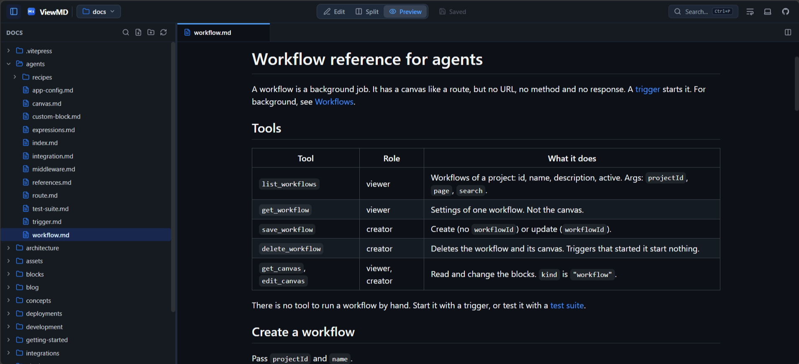

# Welcome to ViewMD 🚀

> **ViewMD** is a fast, bloat-free, 100% client-side Markdown viewer and editor running in your browser with true native performance and zero server dependencies.



---

## ⚡ Quick Highlights

- [x] **Installable PWA with File Handling**: Registered as the default app handler for `.md`, `.markdown`, and `.txt` files in your OS
- [x] **Smart Frontmatter Inspector** with structured table, raw YAML switch, tag badges, and copy action
- [x] **Direct Local Disk Access** via the modern *File System Access API*
- [x] **Dual-Pane Split Editor Groups** with cross-pane tab movement
- [x] **3-Switch View Mode** (Edit Only, Split View, Preview Only)
- [x] **Fuzzy Workspace Search** (`Ctrl+P`) & Full-Text Search (`Ctrl+Shift+F`)
- [x] **Tab Persistence & Pinning** across browser refreshes
- [x] **Word Wrap Toggle** right next to the theme switcher
- [x] **Offline-Ready PWA**: Cached app shell with zero network latency
- [x] **Universal File Support** (Markdown, PDF, Plaintext code buffers)
- [ ] *Coming Soon: `.mdp` Markdown Presentation Slides!*

---

## 📊 GitHub Flavored Markdown (GFM) Showcase

### Tables

| Feature | ViewMD | Obsidian | VS Code Web |
| :--- | :---: | :---: | :---: |
| **Zero Installation** | ✅ Yes | ❌ No (Electron) | ✅ Yes |
| **No Account / Login** | ✅ 100% Local | ✅ Local | ⚠️ Microsoft/GitHub |
| **Direct Disk Read/Write**| ✅ Native API | ✅ Native App | ⚠️ Limited |
| **Lightweight Bundle** | 🚀 < 1.5 MB | 🐢 ~150 MB | 🐢 ~30 MB |
| **Dual Split Panes** | ✅ Included | ✅ Included | ✅ Included |
| **Fuzzy Workspace Search**| ✅ Fuse.js | ✅ Yes | ✅ Yes |

---

### Code Syntax Highlighting

#### TypeScript
```typescript
import Fuse from 'fuse.js';
import type { FileEntry } from './types/fileSystem';

export function quickFind(files: FileEntry[], query: string): FileEntry[] {
  const fuse = new Fuse(files, {
    keys: ['name', 'path'],
    threshold: 0.45,
    ignoreLocation: true,
  });

  return fuse.search(query).map((res) => res.item);
}
```

#### Rust
```rust
fn main() {
    let greeting = "Hello from ViewMD!";
    println!("{greeting}");
}
```

#### Python
```python
def fibonacci(n: int) -> list[int]:
    sequence = [0, 1]
    while len(sequence) < n:
        sequence.append(sequence[-1] + sequence[-2])
    return sequence[:n]

print(fibonacci(8))
```

---

### Quotes & Callouts

> **Pro-Tip**: Press <kbd>Ctrl</kbd> + <kbd>P</kbd> anywhere in ViewMD to immediately jump to any file with fuzzy search!
> You can also press <kbd>Ctrl</kbd> + <kbd>Shift</kbd> + <kbd>F</kbd> to search inside file contents.

---

### Keyboard Shortcuts Reference

| Shortcut | Description |
| :--- | :--- |
| <kbd>Ctrl</kbd> + <kbd>O</kbd> | Open single or multiple files directly from disk |
| <kbd>Ctrl</kbd> + <kbd>S</kbd> | Save current file directly to disk |
| <kbd>Ctrl</kbd> + <kbd>B</kbd> | Toggle file tree sidebar |
| <kbd>Ctrl</kbd> + <kbd>P</kbd> | Fuzzy search & Quick Open files |
| <kbd>Ctrl</kbd> + <kbd>Shift</kbd> + <kbd>F</kbd> | Find in files (Content Search) |
| <kbd>Ctrl</kbd> + <kbd>Enter</kbd> | In search modal: Open file in split side pane |
| <kbd>Middle Click</kbd> | Close tab |

---

*Enjoy writing clean markdown with ViewMD!*
